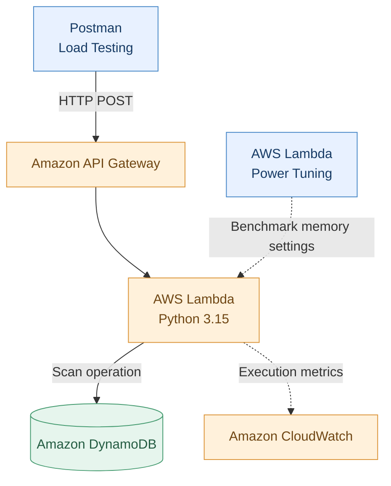

# AWS Serverless Performance Optimization

An evidence-based exploration of AWS Lambda memory sizing, combining **AWS Lambda Power Tuning** (function-level cost/duration) with **Postman load testing** (end-to-end API latency and throughput).

> **Scope:** A single workshop workload and two load-test runs. This is a case study, not a generalized benchmark. The documentation presents the experiment setup, collected evidence, and measured results.

## Architecture

Postman exercises the API Gateway → Lambda → DynamoDB path to measure end-to-end API performance. Separately, the Power Tuning workflow benchmarks Lambda at different memory allocations. CloudWatch captures execution logs and metrics for verification and troubleshooting.

## Experiment setup

| Parameter | Baseline | Updated |
|---|---|---|
| Lambda memory | **128 MB** | **1024 MB** |
| Timeout | 3 seconds indicated by a timed-out sample; configuration not independently captured | **5 seconds** (configuration screenshot) |
| Runtime | Python 3.15 | Python 3.15 |
| Architecture | x86_64 | x86_64 |
| Handler | Not independently verified for baseline | `lambda_function.lambda_handler` |
| Postman load | 10 virtual users, 2-minute ramp-up | 10 virtual users, 2-minute ramp-up |

CloudWatch `REPORT` entries confirm the two memory settings. Runtime and architecture consistency were confirmed by the experimenter.

## Results

| Metric | 128 MB | 1024 MB | Change |
|---|---:|---:|---:|
| Average API response time | 353 ms | 108 ms | **69.4% lower** |
| Throughput | 3.88 requests/s | 4.70 requests/s | **21.1% higher** |
| Requests completed | 489 | 594 | 105 more |
| Reported error rate | 0% | 0% | No change |
| p95 response time | 404 ms | 148 ms | 63.4% lower |
| p99 response time | 2,855 ms | 274 ms | 90.4% lower |

These are **observed differences**, not a controlled causal estimate. Memory and timeout configuration changed, and other factors (cold starts, DynamoDB latency, request distribution) may have contributed. The 128 MB CloudWatch sample that timed out cannot be treated as a representative Postman measurement; see [analysis](load-testing/comparison.md).

### Power Tuning result

Power Tuning evaluated **128, 256, 512, and 1024 MB**, with 10 invocations per configuration and a `cost` optimization strategy. The returned recommendation was **1024 MB**, with reported function duration **45.668 ms** and estimated per-invocation cost **$0.0000007728**. These Power Tuning metrics are not the same as Postman API response times.

[Interactive Power Tuning visualization](https://lambda-power-tuning.show/#gAAAAQACAAQ=;miH8RNBRL0QpHGdDYKw2Qg==;bTKONiDdRTYhyAI2aXJPNQ==)

## Evidence and documentation

- [Power Tuning input and result interpretation](power-tuning/analysis.md)
- [Postman load-test comparison](load-testing/comparison.md)
- [CloudWatch diagnostic excerpts](results/cloudwatch-excerpts.md)
- [Implementation and reproduction guide](docs/implementation.md)
- [Key learnings and limitations](docs/key-learnings.md)
- [Final Lambda configuration screenshots](screenshots/README.md)
- [Postman collection](load-testing/load-testing.postman_collection.json) — uses a placeholder endpoint

## Reproduce (in your own AWS account)

1. Deploy an API Gateway → Lambda → DynamoDB test workload with **appropriate authorization**, least-privilege IAM, and test data only. The supplied sample Lambda in `lambda/` is an **independently written illustrative replacement**, not an assertion of byte-for-byte equivalence with the original workshop function.
2. Configure a Lambda memory-tuning Step Functions workflow in your AWS account. Use `power-tuning/input.example.json` as the experiment input template, replacing the example Lambda ARN and table name with your own test resources. Run the workflow and save its execution output and visualization.
3. Import `load-testing/load-testing.postman_collection.json` into Postman. Set the `baseUrl` collection variable to your own API Gateway origin, without the stage or path. Test with the same load profile before and after changing Lambda memory.
4. Record CloudWatch logs, Lambda settings, Postman reports, and Power Tuning output. Compare runs while noting cold starts, caching, DynamoDB state, and background traffic.

**Security and cost:** Do not expose public write/delete APIs or live endpoints; limit permissions and tear down test resources afterward. AWS resources and test traffic can incur charges.
